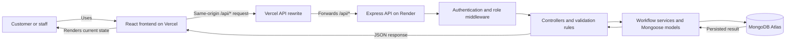

# RepairTrace — Repair Workflow and Accountability Platform

RepairTrace manages laptop and phone repairs from intake through customer approval, quality verification, and handover.

| Resource | Link |
| --- | --- |
| **Live application** | [repairtrace.vercel.app](https://repairtrace.vercel.app) |
| **Backend health check** | [repairtrace.onrender.com/api/health](https://repairtrace.onrender.com/api/health) |
| **GitHub repository** | [alok04966-byte/repairtrace](https://github.com/alok04966-byte/repairtrace) |
| **Demo video** | [drive.google.com/demo/video](https://drive.google.com/file/d/1pCspCBgLIJj3Ujdz1Tdef6l3QLuU93ie/view?usp=sharing) |

The Render health endpoint reports backend and database availability. It is for checking service health; it is not the RepairTrace user interface.

## Problem statement

Small independent laptop and phone repair shops often keep customer devices, reported problems, diagnosis, quotations, approvals, parts delays, repair progress, and handovers across chat applications and manual records. This fragments each repair's history, makes approvals unclear, leads to repeated status enquiries, and makes it difficult to confirm which work was authorized and completed.

A centralized application provides persistent records, controlled workflow transitions, and traceable decisions. Customers and staff can refer to the same repair record while the backend enforces who may see and change it.

## Proposed solution

RepairTrace is a full-stack repair workflow application. Each repair order carries intake details, diagnosis, quotation versions and customer decisions, progress events, quality verification, and handover information through its lifecycle. The backend applies role and ownership rules and validates important state changes.

## Target users and roles

### Customer

- Creates an account through public registration.
- Signs in to view only repairs associated with their account.
- Reviews diagnosis and customer-visible repair progress.
- Reviews quotation versions and approves or declines the current pending quotation for their repair.

### Staff

- Signs in with an account provisioned through the trusted backend process.
- Creates repair orders for registered customers by entering the customer's email address.
- Records diagnosis and creates or revises quotations.
- Manages permitted repair progression, parts blockers, quality checks, and handover.

Public registration creates **customer accounts only**. Shop-owner registration, employee invitations, multi-shop tenancy, and a team-management dashboard are not implemented.

## Key features

- Customer registration, login, logout, and role-based authorization.
- bcrypt password hashing and JWT authentication in an HttpOnly cookie.
- Customer email lookup when staff create a repair; MongoDB ObjectId references remain internal.
- Device intake and unique sequential numeric repair references.
- Diagnosis and itemized quotations with server-calculated INR totals stored as paise.
- Versioned quotations, customer approval or decline, and protection against decisions on stale versions.
- Server-validated repair lifecycle transitions and parts blockers.
- Audit history for important workflow events.
- Required quality checks, failed-check/rework handling, and fresh verification attempts.
- Recorded customer handover before a repair can be marked returned.
- Customer-specific repair visibility and protected staff operations.
- React dashboards, repair details, form feedback, and role-specific interfaces.

Payment processing, inventory management, email/SMS notifications, automated diagnosis, and owner-driven staff management are outside the current implementation.

## Technology stack

| Area | Technology |
| --- | --- |
| Frontend | React 18, Vite 5, React Router 6 |
| Backend | Node.js, Express 5 |
| Database | MongoDB with Mongoose 8 (Atlas for deployment; a configured local MongoDB can be used for development) |
| Authentication | bcryptjs, JSON Web Token, HttpOnly cookies |
| Frontend hosting and API routing | Vercel |
| Backend hosting | Render |

The frontend uses regular CSS; Tailwind CSS is not part of the current dependency set.

## Architecture



In production, `frontend/vercel.json` places the `/api/:path*` rewrite to Render before the React single-page application fallback to `/index.html`. The API client sends relative `/api/...` paths. During local development, Vite proxies `/api` to `http://localhost:5000` instead.

## End-to-end workflow

1. A customer registers and signs in.
2. Authorized staff create a repair for the email address of a registered customer.
3. The backend resolves that email to the customer's database ID and generates a unique repair reference.
4. Staff record device condition, accessories, reported issue, and diagnosis.
5. Staff create an itemized quotation.
6. The owning customer reviews and approves or declines the current quotation.
7. A revised quotation requires fresh approval; decisions on stale versions are rejected.
8. Staff progress the repair through permitted states and record a reason when parts block work.
9. Staff complete the required quality checks. A failed check requires rework and another verification attempt.
10. After all required checks pass, staff mark the repair ready for collection and record handover before it becomes returned.

The backend enforces the workflow and authorization rules. Frontend visibility and protected routes improve the user experience but are not the security boundary.

## Staff registration and evaluator access

> **Staff accounts are not created through public registration.** Public registration always creates a customer, and the registration form cannot select or change a role.

Staff accounts are created using the trusted backend `provision:staff` administrative script. Provisioning values belong in the ignored `backend/.env` file and must never be committed. The script supports:

- `create`: create a new staff account; it refuses to overwrite an existing account.
- `promote`: explicitly promote an existing customer identified by email without changing that account's password. This mode must be selected deliberately.

For creation, set these placeholders in `backend/.env`:

```dotenv
STAFF_PROVISION_MODE=create
STAFF_NAME=<staff display name>
STAFF_EMAIL=<staff email>
STAFF_PHONE=<staff phone>
STAFF_PASSWORD=<strong unique password>
```

From the repository root, run:

```powershell
npm --prefix backend run provision:staff
```

For promotion, set `STAFF_PROVISION_MODE=promote` and `STAFF_EMAIL` for the existing customer account. The other `STAFF_*` fields are not required for promotion. Run the same command. The public registration endpoint cannot grant staff access because the server assigns the customer role itself.

After the account has been created, the staff account and hashed password are stored in MongoDB; the provisioning password does not need to remain in `.env`. For evaluation, use the staff email and password supplied separately in the official submission form. Real credentials do not belong in this README. An instructor can register a separate customer account to test the customer experience.

Owner-created staff accounts and invitation-based onboarding are future scope. They would let shops manage their teams without editing backend environment configuration.

## Evaluator instructions

1. Open the [live RepairTrace application](https://repairtrace.vercel.app).
2. Register a customer account and sign in.
3. Sign in as staff with the credentials supplied in the official submission form.
4. Have staff create a repair using the customer's registered email.
5. Record a diagnosis and create a quotation.
6. Sign in as the customer and approve or decline the quotation.
7. Return to the staff interface to observe the decision and continue the repair lifecycle.
8. Complete quality verification and record handover.
9. Where practical, check that customers cannot access another customer's repair and cannot perform staff-only actions.

The [Render health endpoint](https://repairtrace.onrender.com/api/health) returns backend/database status only. If the deployed Render service uses a free instance that idles, its first response after inactivity may be delayed while it starts.

## Local setup and installation

### Prerequisites

- Node.js 20 or later with npm.
- Access to MongoDB Atlas or a running local MongoDB instance.
- Git.

### Clone and configure the backend

```powershell
git clone https://github.com/alok04966-byte/repairtrace.git
cd repairtrace
Copy-Item backend/.env.example backend/.env
```

Edit `backend/.env`. Set `MONGODB_URI` to the database connection string and replace `JWT_SECRET` with a long, random secret. The staff values in `.env.example` are placeholders; replace them only when provisioning a staff account (or remove them from `.env`). Never commit `.env` files.

Install backend dependencies and start the API in the first terminal:

```powershell
npm --prefix backend install
npm --prefix backend run dev
```

The backend listens on port `5000` by default. If you change `PORT`, update the Vite development proxy target in `frontend/vite.config.js` to match.

### Install and start the frontend

Open a second terminal at the repository root:

```powershell
npm --prefix frontend install
npm --prefix frontend run dev
```

Open the local URL printed by Vite, usually `http://localhost:5173`. The local `/api` proxy forwards requests to `http://localhost:5000`, so browser code uses same-origin relative paths. There is no `VITE_API_BASE_URL` requirement.

### Run checks

From the repository root:

```powershell
npm --prefix backend test
npm --prefix frontend test
npm --prefix frontend run build
```

Backend tests use `mongodb-memory-server` and an isolated temporary database; they do not use the application's `backend/.env` database. Its first run may download a MongoDB binary, so network access may be needed.

## Environment variables

The backend loads `backend/.env` at startup. `backend/.env.example` contains placeholders; copy it to `.env` and supply local values. `.env` files must never be committed.

| Variable | Used for | Required |
| --- | --- | --- |
| `MONGODB_URI` | MongoDB connection used by the API and staff provisioning command. | Yes |
| `JWT_SECRET` | Secret used to sign and verify authentication JWTs. Use a long random value and keep it private. | Yes for authenticated API use |
| `PORT` | Backend HTTP listener port; defaults to `5000`. | No |
| `NODE_ENV` | Runtime mode; production enables the cookie `Secure` flag. Tests set it to `test`. | Set to `production` in production; otherwise optional for local development |
| `STAFF_PROVISION_MODE` | Provisioning mode: `create` or explicit `promote`; creation is the default. | Only when provisioning staff |
| `STAFF_NAME` | Display name for a new staff account. | Required for `create` only |
| `STAFF_EMAIL` | Email for the account to create or promote. | Required for provisioning |
| `STAFF_PHONE` | Phone number for a new staff account. | Required for `create` only |
| `STAFF_PASSWORD` | Password to hash for a new staff account. | Required for `create` only |

The frontend does not read `VITE_API_BASE_URL`: production uses relative `/api/...` requests routed by Vercel, and local development uses the Vite proxy.

## API overview

All endpoints are under `/api`. Protected endpoints use the `auth_token` HttpOnly cookie set by login.

| Method and path | Access | Purpose |
| --- | --- | --- |
| `GET /api/health` | Public | Reports backend and database connection status. |
| `POST /api/auth/register` | Public | Creates a customer account only. |
| `POST /api/auth/login` | Public | Authenticates and sets the session cookie. |
| `GET /api/auth/me` | Authenticated | Returns the current user's safe profile. |
| `POST /api/auth/logout` | Public | Clears the session cookie. |
| `POST /api/repairs` | Staff | Creates a repair using a registered customer's email. |
| `GET /api/repairs` | Authenticated | Lists all repairs for staff or only the caller's repairs for a customer. |
| `GET /api/repairs/:id` | Authenticated | Reads a repair subject to customer ownership. |
| `PATCH /api/repairs/:id/diagnosis` | Staff | Records or updates diagnosis. |
| `POST /api/repairs/:id/quotes` | Staff | Creates the next itemized quotation version. |
| `GET /api/repairs/:id/quotes` | Staff or owning customer | Reads quotation history. |
| `POST /api/repairs/:id/quotes/:version/decision` | Owning customer | Approves or declines the current pending quotation. |
| `PATCH /api/repairs/:id/status` | Staff | Performs a permitted lifecycle transition. |
| `PATCH /api/repairs/:id/quality-checks` | Staff | Records active quality-check results. |
| `POST /api/repairs/:id/handover` | Staff | Records handover for a repair ready for collection. |

Customer access to another customer's repair returns the same not-found response used for a missing repair. Customer responses omit staff-only notes and fields. The backend calculates quotation totals and records decision actors from the authenticated session.

## Testing

The repository's automated commands are:

```powershell
npm --prefix backend test
npm --prefix frontend test
npm --prefix frontend run build
```

At the time of this README update, the backend suite passes **35 tests across 4 suites**, the frontend suite passes **11 tests**, and the Vite production build succeeds. Backend tests cover authentication, provisioning, intake, ownership, quotation versioning/decisions, lifecycle rules, quality verification, and handover. Frontend tests cover API path/proxy behavior, routing helpers, and workflow UI rules.

These are automated local checks. They do not certify a live browser journey, production cookies/CORS, or deployed service availability. The repository's [final verification record](docs/FINAL_VERIFICATION.md) describes manual and production checks that were not performed.

## Deployment

- **Frontend:** [https://repairtrace.vercel.app](https://repairtrace.vercel.app)
- **Backend:** [https://repairtrace.onrender.com](https://repairtrace.onrender.com)
- **Health endpoint:** [https://repairtrace.onrender.com/api/health](https://repairtrace.onrender.com/api/health)

The repository configuration expects the Vercel project root directory to be `frontend` and the Render service root directory to be `backend`. Vercel forwards `/api/:path*` to `https://repairtrace.onrender.com/api/:path*` before applying the `/index.html` SPA fallback. The frontend API client uses relative paths, preserving the Vercel proxy path. The backend requires `MONGODB_URI` and `JWT_SECRET`; set `NODE_ENV=production` for production cookie security. MongoDB Atlas must allow network connections from the deployed backend service.

The source and deployment URLs are documented here, but automated local tests do not verify the current deployed configuration. Confirm service settings and test login/session cookies in the deployed browser environment before relying on production behavior.

## Limitations and future scope

The current application is a single-shop workflow MVP. The following are future enhancements, not current features:

- Shop-owner registration and shop profile setup.
- Shop-specific staff invitations and team management.
- Multi-shop data isolation and authorization.
- Customer and staff account lifecycle management.
- Customer/staff notifications.
- Inventory and parts management.
- Additional operational and business reporting.
